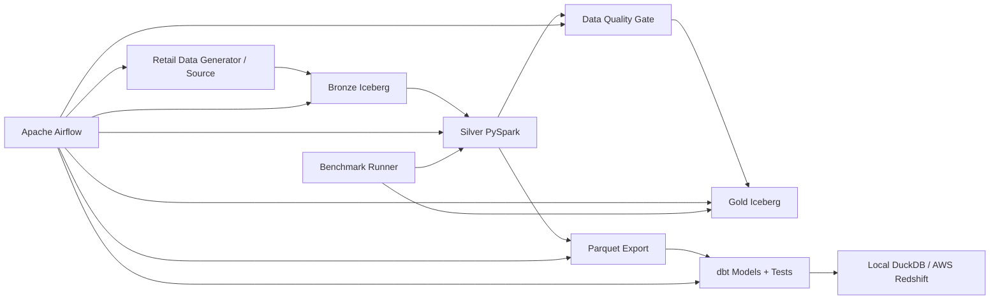

# Scalable Retail Lakehouse & Analytics Platform

A portfolio-grade data engineering project demonstrating **batch ingestion, Apache Iceberg lakehouse design, PySpark transformations, Airflow orchestration, dbt modeling/testing, data quality, incremental processing, SCD Type 2, and performance benchmarking**.

> Benchmark-driven by design: do not claim scale or performance numbers on a resume until you run the project and save evidence in `benchmarks/`.

## Architecture



### Local → AWS mapping

| Local component | AWS target |
|---|---|
| `data/raw/` | Amazon S3 raw zone |
| Local Iceberg warehouse | S3 + AWS Glue Data Catalog + Iceberg |
| Local PySpark | AWS Glue / EMR Spark |
| Airflow DAG | MWAA or self-managed Airflow |
| DuckDB serving demo | Amazon Redshift / Redshift Serverless |
| Local dbt profile | dbt + Redshift adapter |
| Benchmark JSON/logs | CloudWatch + S3 artifacts |

## What this project proves

- Bronze / Silver / Gold lakehouse architecture
- Apache Iceberg tables
- PySpark joins, partitioning, deduplication and window functions
- SCD Type 2 customer dimension
- Airflow orchestration, retries and backfill-friendly design
- dbt staging/marts + automated tests
- Data quality gates before downstream publication
- Incremental/idempotent design patterns
- Performance benchmarking instead of invented metrics

## Quick start

### Prerequisites

- Python 3.11+
- Java 17
- Git
- Optional: Apache Airflow 3.x
- Optional for cloud mode: AWS account + AWS CLI

### Install

```bash
python -m venv .venv

# macOS / Linux
source .venv/bin/activate

# Windows PowerShell
# .venv\Scripts\Activate.ps1

pip install -r requirements.txt
```

The local Spark configuration targets Spark 3.5 with Iceberg 1.11.0 by default.

### Generate sample data

```bash
python -m src.generate_data --orders 500000 --customers 50000 --products 5000
```

Scale run:

```bash
python -m src.generate_data --orders 20000000 --customers 500000 --products 50000 --chunk-size 250000
```

The generator writes in chunks so all orders are not held in memory.

### Run the lakehouse

```bash
python -m src.bronze_ingest
python -m src.silver_transform
python -m src.quality_gate
python -m src.gold_models
python -m src.export_silver
```

### Run dbt

```bash
cd dbt
dbt build --profiles-dir .
cd ..
```

Local dbt uses DuckDB over exported Silver Parquet. For AWS, switch to a Redshift profile.

### Benchmark

```bash
python -m src.benchmark --runs 3
```

Results are written to `benchmarks/benchmark_<timestamp>.json`.

## Airflow

DAG:

```text
airflow/dags/retail_lakehouse.py
```

Flow:

```text
generate → bronze → silver → quality gate → gold → export → dbt build → benchmark
```

Set `RETAIL_PROJECT_ROOT` to the repository's absolute path before running the DAG.

## Data model

### Bronze
Landed rows plus ingestion timestamp and source file.

### Silver
Validated/conformed datasets:
- `silver.customers`
- `silver.products`
- `silver.orders`
- `silver.rejected_orders`

Checks include:
- required keys
- positive amounts
- valid customer/product references
- duplicate order removal
- controlled order status

### Gold
- `gold.dim_customers` — SCD Type 2
- `gold.dim_products`
- `gold.fct_orders`
- `gold.daily_sales`

## Reliability patterns

The project uses deterministic business keys and Iceberg `MERGE` patterns. A production implementation would persist a source watermark such as:

```text
source_updated_at > last_successful_watermark
```

and use Airflow data intervals for backfills.

## AWS deployment path

1. S3 for raw and warehouse data.
2. AWS Glue Catalog as Iceberg catalog.
3. Glue or EMR Spark for transformations.
4. MWAA for orchestration.
5. Redshift Serverless for serving marts.
6. dbt-redshift for serving transformations/tests.
7. CloudWatch for logs/alarms.

Keep credentials out of Git. Use IAM roles/profiles.

## Interview topics

Be ready to explain:
- Why Iceberg vs plain Parquet?
- Spark shuffles and skew
- Broadcast vs sort-merge joins
- Partition pruning
- SCD Type 2
- Idempotency and watermarks
- Airflow retries vs backfills
- Late-arriving data
- Quality gate behavior
- Local-to-AWS migration
- How every benchmark number was measured

## Resume bullet template

Only fill the brackets with measured results:

> Architected an AWS-oriented lakehouse processing **[measured record count]** across Bronze/Silver/Gold layers using PySpark and Apache Iceberg, with schema controls, partitioned storage and automated data-quality gates.

> Designed dimensional models including **SCD Type 2** dimensions with dbt tests and Airflow orchestration; reduced batch runtime by **[measured %]** through join/partitioning optimization and idempotent backfill design.

## Next enhancements

- Glue Catalog + S3 implementation
- Redshift Serverless loader
- Great Expectations/Soda integration
- OpenLineage
- Terraform
- CI with a tiny Spark fixture dataset

## License

MIT

---

## Verified Local Results

The pipeline was validated locally on a synthetic retail workload of **1,000,000 generated orders**.

### Final 1M-order run

- Generated orders: **1,000,000**
- Customers: **100,000**
- Products: **5,000**
- Valid Silver orders: **995,000**
- Rejected orders: **5,000**
- Rejection rate: **0.5%**
- Duplicate order IDs: **0**
- Null order IDs: **0**
- Negative amounts in curated data: **0**
- Orphan customer references: **0**
- Orphan product references: **0**
- Quality gate: **PASS**
- Gold fact rows: **995,000**
- dbt validation: **18/18 PASS**
- pytest: **3/3 PASS**

### Spark Join Benchmark

At the 1M-order scale:

| Strategy | Median Runtime |
|---|---:|
| Standard join | 1.191 s |
| Broadcast join | 0.960 s |

Broadcast join reduced median join runtime by **19.4%** at this scale.

The project also demonstrates that optimization choices should be benchmarked rather than assumed: broadcast joins were slightly slower at smaller 10K and 100K workloads, became beneficial at 500K, and produced the strongest measured improvement at 1M orders.

Benchmark evidence is stored under `benchmarks/`.

