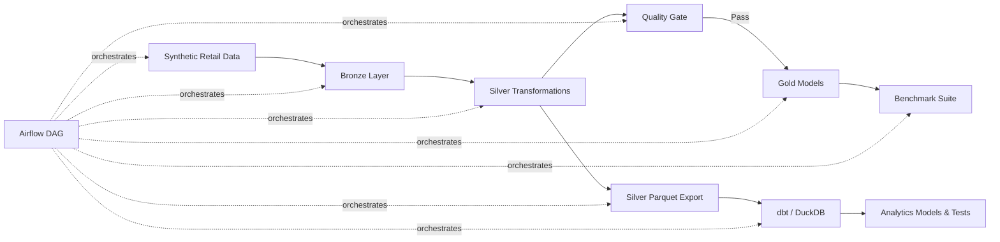

# Scalable Retail Lakehouse & Analytics Platform

A production-style data engineering project that implements a complete **Bronze → Silver → Gold lakehouse pipeline** using PySpark and Apache Iceberg, with automated data-quality validation, dbt analytics models, benchmarking, and orchestration-ready Airflow workflows.

The project was locally validated with **1,000,000 generated retail orders** and includes deliberately injected bad records to test rejection, reconciliation, referential integrity, and data-quality controls.

## Highlights

- Processed **1,000,000 generated retail orders**
- Produced **995,000 validated Silver/Gold fact records**
- Correctly rejected **5,000 invalid records (0.5%)**
- Quality Gate completed with:
  - 0 duplicate order IDs
  - 0 null order IDs
  - 0 negative amounts in curated data
  - 0 orphan customer references
  - 0 orphan product references
- dbt validation: **18/18 models and tests passed**
- Python test suite: **3/3 tests passed**
- Broadcast join optimization measured **19.4% faster** than the standard join at the 1M-order scale
- Apache Iceberg fact tables use **monthly partitioning** to avoid excessive writer fan-out and improve local scalability

> Benchmark results are measured from the local development environment and will vary by hardware and Spark configuration.

---

## Architecture



## Technology Stack

**Data Processing**
- Python
- PySpark
- SQL

**Lakehouse**
- Apache Iceberg
- Parquet

**Analytics Engineering**
- dbt
- DuckDB

**Orchestration**
- Apache Airflow DAG definition

**Cloud-ready configuration**
- AWS-oriented dependency/configuration files
- Example Redshift dbt profile

**Testing & Reliability**
- pytest
- Data-quality reconciliation
- Referential-integrity checks
- Benchmark automation

---

## Repository Structure

```text
.
├── airflow/
│   └── dags/
│       └── retail_lakehouse.py
│
├── benchmarks/
│   ├── README.md
│   └── benchmark_*.json
│
├── config/
│   └── project.yml
│
├── dbt/
│   ├── models/
│   ├── dbt_project.yml
│   ├── profiles.yml
│   └── profiles.redshift.example.yml
│
├── docs/
├── scripts/
├── src/
│   ├── common/
│   ├── generate_data.py
│   ├── bronze_ingest.py
│   ├── silver_transform.py
│   ├── quality_gate.py
│   ├── gold_models.py
│   ├── export_silver.py
│   └── benchmark.py
│
├── tests/
├── .env.example
├── Makefile
├── requirements.txt
├── requirements-airflow.txt
└── requirements-aws.txt
```

---

## Pipeline

### 1. Synthetic Data Generation

The generator creates retail datasets for:

- Customers
- Products
- Orders

Invalid records are intentionally injected so that the pipeline's quality controls can be tested instead of assuming perfect source data.

Example:

```bash
python -m src.generate_data \
  --orders 1000000 \
  --customers 100000 \
  --products 5000
```

The validated 1M-order run contained a configured **0.5% bad-record ratio**.

---

### 2. Bronze Layer

Bronze preserves source-aligned datasets in Apache Iceberg.

```bash
python -m src.bronze_ingest
```

Validated 1M run:

```text
bronze.customers = 100,000
bronze.products  = 5,000
bronze.orders    = 1,000,000
```

---

### 3. Silver Layer

Silver performs:

- Type normalization
- Data validation
- Deduplication
- Customer/product referential validation
- Bad-record isolation
- Curated Iceberg publication

```bash
python -m src.silver_transform
```

Validated result:

```text
silver.customers       = 100,000
silver.products        = 5,000
silver.orders          = 995,000
silver.rejected_orders = 5,000
```

The primary order table is partitioned monthly to maintain a practical partition count while preserving date-based pruning.

---

### 4. Quality Gate

Before Gold publication, the pipeline performs automated reconciliation and integrity checks.

```bash
python -m src.quality_gate
```

Validated 1M-order result:

```json
{
  "bronze_orders": 1000000,
  "silver_orders": 995000,
  "rejected_orders": 5000,
  "rejected_ratio": 0.005,
  "duplicate_order_ids": 0,
  "null_order_ids": 0,
  "negative_amounts": 0,
  "orphan_customers": 0,
  "orphan_products": 0,
  "passed": true
}
```

Gold publication should proceed only when the quality gate passes.

---

### 5. Gold Layer

Gold publishes analytics-ready dimensional models:

```bash
python -m src.gold_models
```

Validated result:

```text
gold.dim_customers = 100,000
gold.dim_products  = 5,000
gold.fct_orders    = 995,000
gold.daily_sales   = 1,004
```

---

## dbt Analytics Layer

Silver datasets can be exported to Parquet and modeled locally using dbt + DuckDB.

Export:

```bash
python -m src.export_silver
```

Run dbt:

```bash
cd dbt
dbt debug --profiles-dir .
dbt build --profiles-dir .
cd ..
```

Final validation:

```text
Models + tests: 18
PASS:           18
WARN:           0
ERROR:          0
```

dbt validates:

- Primary-key uniqueness
- Required fields
- Customer relationships
- Product relationships
- Fact-table integrity

---

## Benchmark Results

The project includes repeatable Spark benchmarks comparing standard and broadcast joins.

```bash
python -m src.benchmark --runs 3
```

| Generated Orders | Valid Orders | Standard Join Median | Broadcast Join Median | Improvement |
|---:|---:|---:|---:|---:|
| 10K | 9,950 | 0.764 s | 0.797 s | -4.32% |
| 100K | 99,500 | 0.921 s | 0.946 s | -2.71% |
| 500K | 497,500 | 1.072 s | 0.947 s | **11.66%** |
| 1M | 995,000 | 1.191 s | 0.960 s | **19.40%** |

An important observation is that broadcasting was not faster at very small scales because its setup overhead outweighed the shuffle savings.

As dataset size increased, the optimization became beneficial. At the validated **1M-order scale**, the benchmark measured a **19.4% reduction in median join execution time**.

This demonstrates why Spark optimization decisions should be based on measured workload behavior rather than applied blindly.

---

## Testing

Run:

```bash
python -m pytest -q
```

Validated result:

```text
3 passed
```

The final pipeline was also validated through:

```text
Synthetic generation
        ↓
Bronze Iceberg
        ↓
Silver transformation
        ↓
Quality Gate
        ↓
Gold models
        ↓
Silver export
        ↓
dbt models/tests
        ↓
Benchmarking
```

---

## Local Setup

### Requirements

- Python 3
- Java 17
- Linux / WSL2 recommended for local Spark + Iceberg execution

Create a virtual environment and install dependencies:

```bash
python -m venv .venv
source .venv/bin/activate

pip install -r requirements.txt
```

Run tests:

```bash
python -m pytest -q
```

---

## Example End-to-End Run

```bash
python -m src.generate_data \
  --orders 100000 \
  --customers 10000 \
  --products 500

python -m src.bronze_ingest
python -m src.silver_transform
python -m src.quality_gate
python -m src.gold_models
python -m src.export_silver

cd dbt
dbt build --profiles-dir .
cd ..

python -m src.benchmark --runs 3
python -m pytest -q
```

---

## Orchestration

An Airflow DAG is included under:

```text
airflow/dags/retail_lakehouse.py
```

The workflow represents:

```text
generate
  → bronze_ingestion
  → silver_transform
  → quality_gate
  → gold_models
  → export
  → dbt_build
  → benchmark
```

The DAG definition is included as the orchestration layer; the primary validation documented in this repository was performed through the local WSL execution path.

---

## Design Decisions

### Medallion Architecture

Bronze, Silver, and Gold separate raw ingestion, validation/standardization, and analytical consumption concerns.

### Apache Iceberg

Iceberg provides table-oriented lakehouse semantics rather than treating the project as a collection of unmanaged Parquet files.

### Monthly Fact Partitioning

Initial daily partitioning created excessive writer fan-out for the local Iceberg workload.

The fact tables were changed to monthly partitioning, reducing partition cardinality while retaining useful temporal pruning.

### Explicit Quality Gate

Gold publication depends on measurable quality conditions rather than assuming upstream transformations are correct.

### Measured Optimization

The project deliberately benchmarks broadcast and non-broadcast joins across multiple dataset sizes. The results demonstrate that an optimization can be counterproductive at small scale and useful at larger scale.

---

## Verified Scale

The largest locally validated execution processed:

```text
Generated orders:       1,000,000
Valid curated orders:     995,000
Rejected orders:            5,000
Customers:                 100,000
Products:                    5,000
Quality gate:                 PASS
dbt checks:              18 / 18 PASS
pytest:                    3 / 3 PASS
Broadcast improvement:       19.4%
```

These are measured project results rather than theoretical target numbers.

---

## Future Enhancements

- Deploy lakehouse storage to Amazon S3
- Integrate AWS Glue Catalog
- Add Redshift serving layer
- Run the supplied Airflow workflow in a persistent deployment
- Add CI/CD validation
- Add incremental ingestion and merge/upsert workflows
- Add Iceberg maintenance procedures such as compaction and snapshot expiration
- Test multi-million-row workloads on larger compute

---

## License

See [LICENSE](LICENSE).